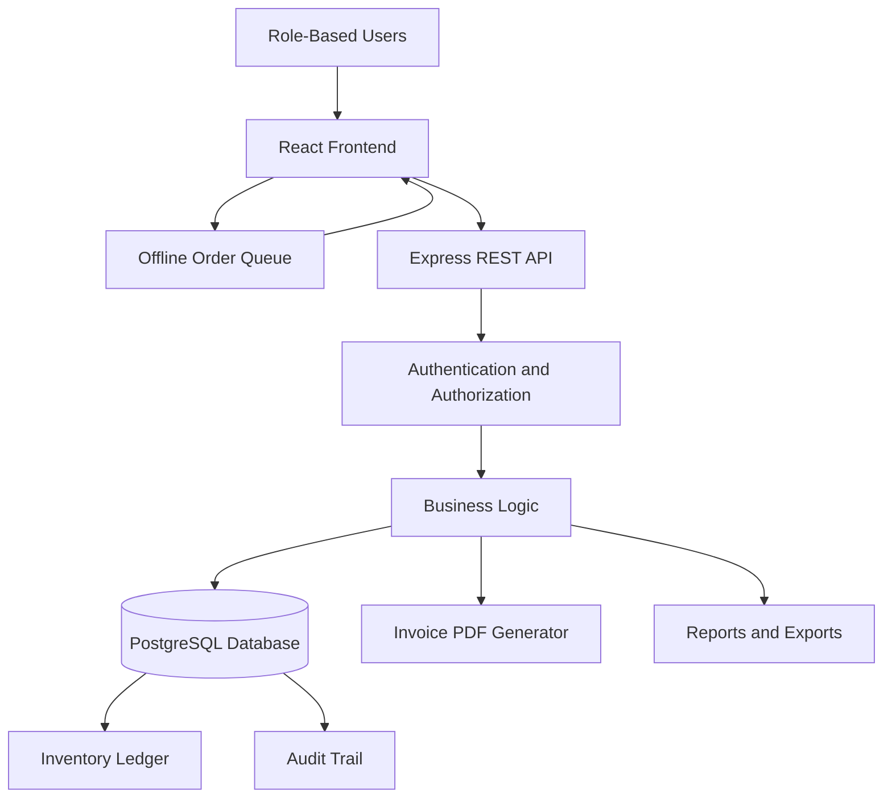

# Order-to-Audit System

### Winter Internship Application — Centre for Digital Infrastructure, NIT Tiruchirappalli

A full-stack, role-based operations management system designed for small food manufacturers. The application integrates sales order management, production planning, inventory tracking, GST invoicing, costing, payment collection and audit reporting into a unified workflow.

## 1. Project Overview

Small food manufacturers often maintain separate records for sales, purchases, production, inventory and accounting. This creates difficulties in stock reconciliation, production costing, order fulfillment and financial reporting.

The Order-to-Audit System addresses these challenges by connecting every operational transaction to a traceable inventory and audit record.

**Core objectives**

- Simplify mobile sales order capture.
- Prevent order approval when available stock is insufficient.
- Generate GST invoices with intrastate and interstate tax calculations.
- Track raw materials, packaging materials and finished goods.
- Monitor BOM consumption, production yield and wastage.
- Calculate production cost and profitability.
- Track payments and outstanding customer balances.
- Provide audit-ready reports and role-based dashboards.

## 2. Technology Stack

| Layer | Technology |
|---|---|
| Frontend | React, TypeScript, Vite |
| User Interface | CSS, Tailwind CSS, Lucide React |
| Backend | Node.js, Express.js |
| Database | PostgreSQL 16 |
| Authentication | JWT, bcrypt |
| Validation | Zod |
| Financial Calculations | Decimal.js |
| Invoice Generation | PDFKit |
| Offline Support | Service Worker, LocalStorage |
| Deployment | Docker, Docker Compose |
| Version Control | Git, GitHub |

## 3. System Architecture



The frontend communicates with the backend through REST APIs. Business rules, authentication, authorization and financial calculations are enforced on the server. PostgreSQL transactions maintain consistency between operational documents and stock movements.

## 4. User Roles

| Role | Responsibilities |
|---|---|
| Salesman | View products and prices, create orders, synchronize offline orders and track own sales |
| Administrator | Review, edit, approve or reject orders, generate invoices, dispatch goods, record payments and configure settings |
| Production | Record purchases, review BOMs, submit production runs and monitor material consumption |
| Auditor | Read-only access to inventory, invoices, reports and audit records |
| Owner | Monitor business performance, stock, production costs, margins and outstanding balances |

Role restrictions are enforced at both the frontend and API levels.

## 5. Key Features

### Sales and Mobile Ordering

- Responsive interface suitable for mobile devices.
- Customer and product selection.
- Product price list and estimated order value.
- Order status tracking.
- Customer-wise and product-wise sales summaries.
- Salesman-specific order visibility.
- Offline order capture with persistent local queue.
- Synchronization after connectivity is restored.
- UUID-based protection against repeated submission of the same request.

### Order Administration

- Review submitted orders.
- Modify order quantities and selling prices before approval.
- Approve or reject orders.
- Check available finished stock before approval.
- Account for quantities reserved by approved and invoiced orders.
- Prevent dispatch when physical stock is insufficient.
- Maintain an audit history of operational actions.

### GST Invoicing and Collections

- CGST and SGST for intrastate transactions.
- IGST for interstate transactions.
- Financial-year-aware invoice numbering.
- Customer GSTIN, product HSN and billing information.
- Billing snapshots to preserve invoice information.
- Downloadable invoice PDFs.
- Native file sharing where supported, with manual attachment fallback.
- Dispatch tracking.
- Partial payment recording.
- Outstanding balance and customer ageing reports.

### Production and BOM Management

- Standard Bill of Materials for each configured product.
- Expected and actual production quantities.
- Material consumption and packaging damage tracking.
- Automatic raw material and packaging stock deductions.
- Automatic finished goods stock addition.
- Material and yield variance calculations.
- Configurable variance tolerance.
- Labour and energy overhead allocation.
- Production cost per packet and estimated gross margin.

### Inventory Management

- Separate raw material, packaging and finished goods classifications.
- Movement-based inventory ledger.
- Source-document references for stock movements.
- Purchase receipts, production consumption, production output and dispatch entries.
- Stock balance reconciliation.
- Supported weight, volume and discrete-unit conversions.
- Configurable carton-to-packet or carton-to-piece conversion.

### Reports and Dashboards

The application provides 13 report types:

1. Sales register
2. Customer-wise sales
3. Product-wise sales
4. GST summary
5. Purchase register
6. Stock summary
7. Stock ledger
8. Production summary
9. Material consumption
10. Collections
11. Receivables
12. Customer ageing
13. Audit trail

Reports support date-range filtering, CSV download and browser-based PDF export.

The owner dashboard provides sales performance, stock balances, production alerts, cost per packet, margins, collections and outstanding receivables.

## 6. Local Installation

### Prerequisites

- Git
- Docker Desktop with Docker Compose
- Node.js 22 LTS or another version compatible with the frontend dependencies
- npm
- Modern web browser

### Clone the repository

```bash
git clone https://github.com/jyothiswaroopsaikollipara-rgb/order-to-audit-system.git
cd order-to-audit-system
```

### Configure environment variables

Copy `.env.example` to `.env`.

Windows PowerShell:

```powershell
Copy-Item .env.example .env
```

Linux or macOS:

```bash
cp .env.example .env
```

Open `.env` and configure the required database password, JWT secret and demo account password using the provided template.

Keep the `.env` file private. Do not commit actual secrets to GitHub.

### Start the backend and database

```bash
docker compose up -d --build
```

Docker Compose starts PostgreSQL and the Express API. The database is initialized with benchmark master data, demo users and opening stock. Database migrations are applied during backend startup.

Check the running services:

```bash
docker compose ps
```

Backend health endpoint:

```text
http://localhost:3000/health
```

Expected response:

```json
{"status":"ok"}
```

### Start the frontend

Open another terminal:

```bash
cd frontend
npm ci
npm run dev
```

Open the application:

```text
http://localhost:5173
```

### Production-build preview

To test the production frontend build and service worker:

```bash
cd frontend
npm run build
npm run preview -- --port 4173
```

Open:

```text
http://localhost:4173
```

Keep the backend running while using either frontend mode.

### Stop the application

```bash
docker compose stop
```

This preserves the database volume.

For a fresh, isolated demonstration, use a different Docker Compose project name rather than deleting an existing database.

## 7. Demo Login Accounts

All demo accounts use the password configured as `DEMO_PASSWORD` in the local `.env` file.

| Role | Email |
|---|---|
| Salesman A | salesa@example.test |
| Salesman B | salesb@example.test |
| Administrator | admin@example.test |
| Production | production@example.test |
| Auditor | auditor@example.test |
| Owner | owner@example.test |

These accounts are intended only for local demonstration.

## 8. Benchmark Scenario

The database is seeded with the benchmark product, customers, BOM and opening inventory.

### Opening Inventory

| Item | Quantity | Unit | Unit Cost (INR) |
|---|---:|---|---:|
| Flour | 100 | kg | 42.00 |
| Cooking oil | 30 | litre | 140.00 |
| Spice mix | 5 | kg | 200.00 |
| Pouches | 500 | piece | 2.50 |
| Cartons | 30 | piece | 15.00 |
| Murukku 200 g | 50 | packet | — |

Product selling price: INR 50 per packet.

GST rate: 5%.

Manufacturing location: Tamil Nadu.

### Purchase Transaction

Purchase 60 kg of flour at INR 45 per kg.

Purchase value: INR 2,700.

Weighted-average flour cost:

```text
(100 × 42 + 60 × 45) / 160
= INR 43.125 per kg
```

### Production Transaction

Expected production: 200 packets.

Actual good output: 188 packets.

| Material | Standard | Actual | Variance |
|---|---:|---:|---:|
| Flour | 40 kg | 40 kg | 0% |
| Cooking oil | 10 L | 10.5 L | +5% |
| Spice mix | 1.2 kg | 1.2 kg | 0% |
| Pouches | 200 | 194 | -3% |
| Cartons | 10 | 9 | -10% |

The 194 consumed pouches include six damaged pouches.

Labour overhead: INR 1,200.

Energy overhead: INR 600.

### Production Results

| Metric | Expected Result |
|---|---:|
| Material cost | INR 4,055.00 |
| Total overhead | INR 1,800.00 |
| Total production cost | INR 5,855.00 |
| Cost per good packet | INR 31.14 |
| Production yield | 94% |
| Yield variance | -6% |
| Estimated profit per packet | INR 18.86 |
| Estimated gross margin | 37.71% |
| Finished stock after production | 238 packets |

At the default 3% tolerance, oil consumption, carton consumption and production yield generate variance alerts. A variance exactly equal to the tolerance does not generate an alert.

### Sales Order and Invoice

Retailer A, Tamil Nadu, orders 150 packets.

| Invoice Component | Amount (INR) |
|---|---:|
| Taxable amount | 7,500.00 |
| CGST at 2.5% | 187.50 |
| SGST at 2.5% | 187.50 |
| IGST | 0.00 |
| Invoice total | 7,875.00 |
| Payment received | 4,000.00 |
| Outstanding amount | 3,875.00 |

Dispatching 150 packets reduces finished stock from 238 to 88 packets.

### Insufficient Stock Scenario

Distributor B, Karnataka, orders 120 packets.

```text
Requested quantity = 120
Available quantity = 88
Shortage = 32 packets
```

The order remains submitted, and approval is blocked.

### Expected Final Inventory

| Item | Closing Quantity |
|---|---:|
| Flour | 120 kg |
| Cooking oil | 19.5 L |
| Spice mix | 3.8 kg |
| Pouches | 306 pieces |
| Cartons | 21 pieces |
| Finished goods | 88 packets |

### Expected Transaction Counts

For a clean execution of the benchmark:

| Transaction | Count |
|---|---:|
| Purchases | 1 |
| Production runs | 1 |
| Sales orders | 2 |
| Invoices | 1 |
| Dispatches | 1 |
| Payments | 1 |
| Stock movements, including opening entries | 14 |

## 9. Engineering Design

### Inventory Ledger

Inventory balances are derived from signed stock movements:

```text
Closing Stock = Opening Stock + Receipts - Issues
```

Purchases, production and dispatch operations create traceable movement entries linked to their source documents.

### Transaction Consistency

Inventory-changing operations use PostgreSQL transactions and a shared inventory mutex row lock.

This design serializes inventory posting operations, reducing stock race conditions and simplifying consistency for a small manufacturing business.

### Stock Reservation

Order approval considers physical stock and quantities already committed to approved or invoiced orders.

Dispatch performs a further stock availability check before recording the inventory deduction.

### Costing Method

Material valuation uses weighted-average rates calculated from opening inventory and recorded purchases.

Production cost is calculated as:

```text
Material Cost = Sum of Actual Quantity × Weighted Average Rate

Total Production Cost = Material Cost + Labour + Energy

Cost per Packet = Total Production Cost / Good Output
```

This method is suitable for demonstrating the specified benchmark. It is not a complete perpetual moving-average inventory valuation system.

### Variance Monitoring

```text
Variance (%) = (Actual - Standard) / Standard × 100

Yield (%) = Good Output / Expected Output × 100
```

An alert is generated when the absolute variance exceeds the configured tolerance.

### Offline Synchronization

Orders can be stored in a user-specific local queue when connectivity is unavailable.

Each queued order retains its original request UUID. When connectivity returns, the application attempts to synchronize pending requests.

Authentication tokens and passwords are not persisted in the offline order queue.

The production frontend build also caches the application shell through a service worker.

## 10. API Overview

| Method | Endpoint | Purpose |
|---|---|---|
| POST | /auth/login | Authenticate user |
| GET | /masters | Retrieve master data |
| GET | /dashboard/summary | Role-specific dashboard |
| GET | /orders | View permitted orders |
| POST | /orders | Submit sales order |
| POST | /orders/:id/edit | Edit submitted order |
| POST | /orders/:id/approve | Approve order |
| POST | /orders/:id/reject | Reject order |
| POST | /orders/:id/invoice | Generate invoice |
| GET | /invoices | View invoices |
| GET | /invoices/:id/pdf | Download invoice |
| POST | /invoices/:id/dispatch | Dispatch goods |
| POST | /invoices/:id/payments | Record payment |
| POST | /purchases | Record purchase |
| GET | /production/boms | View BOM standards |
| POST | /production-runs | Record production |
| GET | /production/settings | View variance settings |
| POST | /production/settings | Configure tolerance |
| GET | /stock | View stock balances |
| GET | /stock/ledger | View stock movements |
| GET | /reports/monthly/:type | Retrieve or export reports |

Protected endpoints require a valid JWT and the appropriate user role.

## 11. Repository Structure

```text
order-to-audit-system/
├── frontend/
│   ├── public/
│   │   └── sw.js
│   ├── src/
│   │   ├── App.tsx
│   │   ├── BusinessDashboard.tsx
│   │   ├── MobileOrderEntry.tsx
│   │   ├── ReportsCentre.tsx
│   │   └── offlineOrders.ts
│   └── package.json
├── src/
│   ├── server.js
│   ├── seed.js
│   ├── migrate.js
│   ├── math.js
│   ├── invoicePdf.js
│   ├── dashboard.js
│   └── reports.js
├── sql/
├── migrations/
├── tests/
├── Dockerfile
├── docker-compose.yml
├── .env.example
├── .gitignore
├── package.json
└── README.md
```

Selected files are shown for clarity.

## 12. Testing and Validation

Backend checks:

```bash
npm ci
npm run check
npm test
npm audit
```

Frontend checks:

```bash
cd frontend
npm ci
npm run lint
npm run build
npm audit
```

The project includes automated tests for financial calculations, GST, material variance, production costing and unit conversions.

Manual integration testing has verified:

- Purchase and production transactions.
- Material damage recording.
- Inventory reconciliation.
- Intrastate GST calculations.
- Interstate GST calculations.
- Invoice PDF generation.
- Billing snapshot persistence.
- Insufficient stock protection.
- Dispatch and payment tracking.
- Salesman-specific order visibility and ownership.
- Offline order creation and synchronization.
- Auditor access restrictions, including seven restricted API operations returning HTTP 403.
- Monthly reports and CSV/PDF exports.
- Owner dashboard calculations.

Additional test transactions were performed in isolated Docker Compose environments to preserve benchmark data.

## 13. Security and Auditability

- JWT-based authentication.
- Password hashing with bcrypt.
- Server-side role-based authorization.
- Input validation.
- Parameterized database queries.
- Transaction-based inventory updates.
- Source-linked stock movements.
- Audit events recording actors and operational actions.
- Environment-based secret configuration.
- No committed local environment secrets.

## 14. Known Limitations and Future Improvements

This application is an internship prototype and is not a certified GST accounting or production ERP system.

Current limitations include:

- Offline order capture requires a previously authenticated session; offline login is not supported.
- Synchronization operates through the active ordering interface rather than a dedicated background synchronization service.
- Offline order data is stored locally and is not encrypted.
- Invoice sharing uses native file sharing or manual attachment; public invoice links and automated email delivery are not implemented.
- Material valuation is not a perpetual moving-average inventory costing ledger.
- Batch and expiry tracking, returns, credit notes and partial dispatches are not implemented.
- GST reports are structured summaries, not direct government portal filing integrations.
- Customer ageing is based on invoice dates rather than configurable payment due dates.
- Dedicated concurrent transaction stress tests and broader idempotency integration tests remain future work.
- Production deployment requires HTTPS, stronger session management, rate limiting, backup procedures and additional security review.

Only synthetic demonstration data should be used with this prototype.

## 15. Conclusion

The Order-to-Audit System demonstrates an integrated manufacturing workflow connecting sales, production, inventory, GST invoicing, collections and audit reporting.

Its transaction-based inventory design, role-specific interfaces, offline sales support and reproducible benchmark calculations provide a practical foundation for digitizing small food manufacturing operations.

---

Developed for the Winter Internship Application, Centre for Digital Infrastructure, NIT Tiruchirappalli.